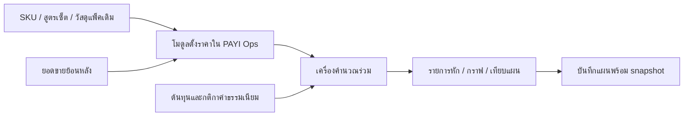

# ข้อกำหนดล่าสุด: เปิดเฉพาะบัญชี dev เพื่อตรวจงานก่อน

คำสั่งผู้ใช้ล่าสุดแทนแผนเปิด dev/boss ด้านล่าง ยังไม่เปิดให้ boss จนกว่าจะได้รับคำสั่งใหม่ ดูสถานะติดตั้งใน pricing-setup.th.md

# PAYI Ops: แผนระบบตั้งราคาและกำไรรายสินค้า / เซ็ต

วันที่ 14 ตุลาคม 2569 · สถานะ: แผนออกแบบ ยังไม่ได้แก้แอป เชื่อมฐานจริง หรือเปิดใช้กับร้านค้า

อัปเดตการลงมือทำ: เพิ่มหน้า Pricing ในแอปและ API สำหรับสองบัญชี `dev`,`boss` แล้ว มีคำนวณเซ็ต/โปรแกรม/กราฟ/ราคาเป้าหมาย เปิดและดาวน์โหลดไฟล์แผน พร้อมบันทึก revision ผ่าน private sheet เมื่อกำหนด config ดู `docs/pricing-setup.th.md` ยังไม่ได้เชื่อมฐานจริงหรือ deploy

อัปเดตการเชื่อมข้อมูล: ต่อทะเบียนและ metadata สินค้า ราคาอ้างอิงคลัง ยอดขายย้อนหลัง 30/90 วัน สูตรเซ็ต และการจำต้นทุนจากแผนส่วนตัวแล้ว ทดสอบอ่านข้อมูล Ops จริงสำเร็จโดยไม่เขียนฐานเดิม การอ่านข้อมูลจริงผ่านหน้า/API ต้องล็อกอินบัญชีที่มีสิทธิ์ ส่วนการบันทึกแผนถาวรยังต้องตั้งชีตส่วนตัว ยังไม่ได้ deploy

## ขอบเขตล่าสุดที่ผู้ใช้ยืนยัน (v3)

อัปเดตพื้นฐานการคำนวณตามคำสั่งล่าสุด: ใช้รูปแบบ สวิตช์ ตารางหมวด/วิธีชำระ และเลขเริ่มต้นจากเว็บ tainiyom.github.io/shopee-calculator-/ ให้พร้อมคำนวณทันทีและแก้ตัวเลขเองได้ ไม่รอขั้นยืนยันอัตราก่อนใช้ เปิดสวิตช์จึงคิดงบรายการนั้น Campaign/Voucher/Exclusive/Affiliate/Ads คิด % ของราคาขายตามเว็บ ไม่ลดฐานค่าธรรมเนียมซ้ำ ส่วน Exclusive ไม่ใช่ช่องราคาบาท แผนเก่าเก็บสูตรเดิมไว้จนผู้ใช้เลือกแปลง ดูรายละเอียดปัจจุบันใน `docs/pricing-setup.th.md`

ใช้คำนวณและบันทึกแผนตั้งราคาสินค้าเดี่ยว/เซ็ต พร้อมกราฟจำลองเท่านั้น ไม่เก็บเงินรับจริง ไม่นำเข้ารายงาน settlement และไม่ทำการเทียบกำไรจริงหลังขาย

ช่วงพัฒนาและปรับระบบ เปิดให้บัญชีของผู้ใช้กับบัญชีบอสสองคนดูและแก้ข้อมูลจริงได้ครบ เมื่อเข้าที่แล้วจึงถอนสิทธิ์ผู้ใช้ตามคำสั่ง เหลือบอสคนเดียว ไม่ถอนตามเวลาอัตโนมัติ กำหนดสิทธิ์เป็นรายบัญชี ไม่เปิดให้ทุกคนที่มี role dev หรือ boss และไม่เปลี่ยนสิทธิ์ในโมดูล Ops อื่น

ข้อกำหนดนี้แทนข้อเสนอ dev-only และแผนเก็บเงินรับจริงในร่างก่อนหน้า ผลตรวจและร่าง v1 ด้านล่างเป็นประวัติการออกแบบ

## ผลตรวจแผนก่อนปรับ (Senior Review)

ประเมินร่าง v1: mixed เป้าหมายและขั้นตอนใช้งานชัด แต่ยังต้องระบุที่มาของต้นทุน กติกากล่องต่อออเดอร์ และการบันทึกให้ละเอียด ผู้ตรวจอิสระไม่พบ blocker ที่แก้ไม่ได้ และพบ major 5 เรื่องที่ปรับในแผนฉบับนี้แล้ว:

| ประเด็น | หลักฐาน | สิ่งที่ปรับใน v2 |
|---|---|---|
| กล่องพัสดุคิดตามออเดอร์ แยกจากแพ็คต่อสินค้า | `api/_lib/packagingOrderRules.js:1` | เพิ่มกฎกล่องและสมมติฐานจำนวนหน่วยต่อออเดอร์ |
| มีแหล่งต้นทุนบางส่วนและ Core อีกชุด | `api/_lib/importTracking.js:237`, `backend/core/packages/money/src/calculator.ts:62` | ตรวจแหล่งที่ใช้งานจริงก่อนเลือกผู้เป็นเจ้าของต้นทุน |
| สูตรใน `set_recipes` บางรายการเป็นการแก้รหัสย้อนหลัง | `api/planner-sales.js:7` | ให้ยืนยันว่าเป็นเซ็ตขายจริงก่อนนำเข้าแผนราคา |
| boss เห็นเมนูใหม่โดย default | `shared/roles.js:34` | ระบุการปิดเมนูและ dev guard ของ API แยกกัน |
| writer เดิมแปลงชนิดข้อมูลและยังไม่รับประกัน concurrent save | `api/_lib/sheets.js:274` | เพิ่ม adapter เฉพาะ pricing, RAW, เวอร์ชัน และสถานะไม่ทราบผลบันทึก |

Minor ที่แก้พร้อมกัน: บันทึก engine/schema version, แยกหน่วยยอดขาย/ออเดอร์ และระบุสถานะการแชร์ชีตว่าเป็นข้อมูลจากเอกสารที่ยังไม่ยืนยัน live

สิ่งที่คงไว้: ทำใน Ops เดิม, เก็บ snapshot ย้อนหลัง, ฐานต้นทุนส่วนตัว, คำนวณ slider ในหน้าเว็บและตรวจบน server และเริ่มจากตัวอย่างสินค้าเดี่ยว/เซ็ตก่อน

## แผนที่ปรับแล้ว (v3)

## เป้าหมายและตัวอย่างการใช้งาน

เจ้าของร้านเปิดเมนู “ตั้งราคาและกำไร” เลือกสินค้าเดิมหรือเซ็ต ดึงต้นทุนที่ยืนยันไว้ เลือกร้านและโปรแกรมที่เข้าร่วม จากนั้นเลื่อนราคาขาย ดูรายการหักและกราฟกำไรตามยอดขาย เปรียบเทียบราคาเดิมกับราคาเสนอ แล้วบันทึกเป็นแผนของสินค้านั้น วันถัดมาเปิดกลับมาเห็นสูตรและเหตุผลที่เลือกไว้ครบ

ข้อเสนอคือเพิ่มโมดูลใน PAYI Ops ปัจจุบัน ใช้บัญชีและทะเบียนสินค้าเดิม เริ่ม Shopee ก่อน แล้วเพิ่มช่องทางอื่นผ่านกติกาของแต่ละแพลตฟอร์ม รักษาเงื่อนไขใช้บริการฟรีของโปรเจกต์

ราคาที่เลือกในโมดูลคือแผนภายใน การอัปเดตราคาใน Shopee เป็นงานอีกขั้นที่ต้องตรวจสิทธิ์และการเชื่อมต่อจริงก่อน

## หลักฐานจากโปรเจกต์

ตรวจจาก source code ในเครื่อง ไม่ได้ตรวจ deployment, การแชร์ไฟล์ หรือข้อมูลร้านค้าจริง

| สิ่งที่มี | ใช้ต่ออย่างไร | แหล่งในโค้ด |
|---|---|---|
| React/Vite + Recharts และเมนูแบบ tab | เพิ่มหน้าในระบบและใช้กราฟเดิม | `package.json`, `src/App.jsx:107`, `src/App.jsx:114` |
| บัญชีและ role เดิม | ตรวจสิทธิ์หน้าและ API | `shared/roles.js:1`, `api/sheet-tools.js:4109` |
| `product_aliases` และ SKU redirect | จับคู่สินค้าจากแต่ละช่องทางกับ SKU หลัก | `api/_lib/skuMapping.js:11`, `api/products.js:40` |
| `set_recipes` | อ่านส่วนประกอบเซ็ตโดยคำนึงถึง variation | `api/_lib/skuMapping.js:11` |
| `inventory_items`, `retail_price` | รายการสินค้าและราคาอ้างอิงในคลัง | `api/_lib/inventory.js:19` |
| `packaging_recipes` | แนะนำวัสดุแพ็คที่สัมพันธ์กับสินค้า | `api/_lib/inventory.js:57` |
| `packaging_qty_rules`, `packaging_combo_rules` | แนะนำกล่องพัสดุตามส่วนประกอบทั้งออเดอร์ | `api/_lib/packagingOrderRules.js:1` |
| ออเดอร์และรายงานสินค้า | ใช้จำนวนขายย้อนหลังเป็นฐานการจำลอง | `api/products.js:74` |
| ค่าใช้จ่ายนำเข้าต่อล็อต | ใช้ประกอบการกรอกต้นทุนเมื่อยืนยันการจัดสรรแล้ว | `api/_lib/importTracking.js:237` |
| API ข้าม spreadsheet | ใช้เป็นตัวอย่างสำหรับฐานต้นทุนแยก | `api/_lib/sheets.js:227` |
| Core/PostgreSQL แยกอยู่ใน repo | เก็บเป็นทางย้ายภายหลัง ไม่มีหลักฐานว่ารับช่วงฐานเว็บเดิมแล้ว | `backend/core/README.md` |

ข้อจำกัด: `cost_per_pc` ใน Import Tracking มาจาก service fee, advance VAT และ other fee หารจำนวนรวม จึงยังใช้เป็นต้นทุนสินค้ารวมต่อ SKU ทันทีไม่ได้ ส่วนออเดอร์เดิมไม่มีรายการหักการเงินครบสำหรับยืนยันกำไรจริง

Core มี `app.product_costs` และตัวคำนวณ historical snapshot อยู่แล้ว (`backend/core/packages/money/src/calculator.ts:62`) กับ decimal arithmetic (`backend/core/packages/money/src/decimal.ts:1`) ขั้น discovery ต้องตรวจว่าใช้งานกับร้านนี้จริงหรือไม่ ถ้าใช่ให้เลือกอ่าน/นำเข้าต้นทุนที่ยืนยันจาก Core ถ้าไม่ใช่ให้กรอก versioned cost ใน pricing ก่อน ต้องกำหนดเจ้าของต้นทุนหลักราย SKU ให้ชัด ไม่เขียนสองฐานพร้อมกัน

เอกสาร `CLAUDE.md` ระบุว่าชีตหลักเคยแชร์แบบเปิดลิงก์ ต้องตรวจการแชร์จริงก่อนใช้งานข้อมูลต้นทุน ข้อเสนอเริ่มต้นคือเก็บข้อมูลราคาและต้นทุนใน spreadsheet ส่วนตัวแยก ผ่าน `PRICING_SHEET_ID` และ backend เท่านั้น

## หน้าจอที่ต้องมี

### รายการแผนราคา

- ค้นหาด้วยชื่อหรือ SKU กรองธุรกิจ ร้าน ช่องทาง และสินค้าเดี่ยว/เซ็ต
- แสดงราคาอ้างอิง ราคาเสนอ ต้นทุน กำไรหลังค่าใช้จ่ายผันแปร และวันแก้ไขล่าสุด
- แยกสถานะ ร่าง / เลือกใช้ภายใน / ต้องคำนวณใหม่ / ข้อมูลไม่ครบ
- เปิดแผนเดิม ทำสำเนาเปรียบเทียบ และย้อนดูประวัติได้
- ราคาอ้างอิงจากคลังต้องติดป้ายแหล่งข้อมูล ไม่แสดงเป็นราคาปัจจุบันบน marketplace หากยังไม่ได้เชื่อม

### เครื่องคำนวณและจำลอง

ซ้ายเป็นสินค้า ต้นทุน ร้าน หมวดสินค้า วิธีชำระเงินและโปรแกรม ขวาเป็นรายการรายรับ/รายการหักพร้อมยอดกำไร ด้านล่างเป็นกราฟและการเทียบแผน

รองรับองค์ประกอบจากภาพ: ร้านทั่วไป/Mall, Commission, Transaction, Platform Fee, PRIME Seller, Xtra, เงื่อนไขร้านยอดขายต่ำ, แคมเปญ, Seller Voucher, Flash Sale, Flash Sale Dynamic, Exclusive Price, Affiliate และ Ads

แต่ละรายการต้องกำหนดว่าเป็นส่วนลด ค่าธรรมเนียม ค่าใช้จ่าย หรือราคาเฉพาะช่องทาง เพื่อไม่หักซ้ำ ค่าเริ่มต้นโปรแกรมเสริมเป็นปิด ยกเว้นโปรไฟล์ร้านที่ผู้ใช้ยืนยันไว้ โปรแกรมที่ยังไม่ยืนยันกติกาแสดง “รอยืนยันเงื่อนไข”

เครื่องคำนวณมีสองโหมด: “หาราคาขายจากกำไรเป้าหมาย” และ “คำนวณกำไรจากราคาขาย” แยกกำไรเป้าหมายเป็นบาท/หน่วย หรือ margin บนยอดขาย ไม่ปนกับ markup บนต้นทุน

### จัดเซ็ตและต้นทุน

- เลือก SKU ส่วนประกอบและจำนวน เช่น A × 2 + B × 1 + กล่องเซ็ต
- ต้นทุนเซ็ต = ผลรวมต้นทุนส่วนประกอบตามจำนวน + วัสดุแพ็ค + ค่าเตรียมเซ็ตที่ยังไม่รวมในรายการอื่น
- ใช้ key เซ็ตพร้อม variation ตามของเดิม ตั้งรหัสภายในแยกสำหรับเซ็ตใหม่ที่ยังไม่ขาย
- อ่านสูตรเดิมเป็นจุดเริ่มต้น แสดงให้ยืนยันก่อนบันทึกเป็น snapshot ของแผนราคา
- `set_recipes` มีทั้งเซ็ตจริงและแถวแก้รหัสเก่าที่ `keep_set_sales=0` จึงนำเข้าเป็นรายการรอยืนยันก่อน เก็บ original listing SKU/variation แยกจากรหัสส่วนประกอบหลัง redirect และไม่ถือว่าทุกสูตรคือเซ็ตขาย
- แยกแพ็คต่อชิ้นออกจากกล่องพัสดุต่อออเดอร์ อ่าน `packaging_qty_rules`/`packaging_combo_rules` แล้วเก็บกฎที่ใช้กับ snapshot ถ้าเป็น fallback ต้องติดป้ายประมาณการ ถ้าไม่มีกฎให้กรอกต้นทุนกล่องเอง
- รอบแรกระบุสมมติฐานหนึ่ง SKU/เซ็ตที่เลือกต่อออเดอร์ พร้อมจำนวนหน่วยต่อออเดอร์ การจำลองตะกร้าผสมหลายสินค้าทำภายหลังเมื่อมีกฎที่ตรวจแล้ว
- การเปลี่ยนสูตรจำลองไม่แก้ `set_recipes`, คลัง หรือยอดวางแผนเดิม การส่งสูตรใหม่ไปใช้งานคลังเป็น flow แยกพร้อมแสดงผลกระทบ
- หากส่วนประกอบขาดต้นทุน ต้องระบุรายการที่ขาดและงดแสดงกำไรสรุปเป็นตัวเลขยืนยัน ห้ามแทนต้นทุนที่ขาดด้วยศูนย์
- เริ่มเซ็ตชั้นเดียว การนำเซ็ตมาประกอบเซ็ตต้องตรวจวงจรและกำหนดรูปแบบให้ชัดก่อนเปิดใช้

### ตั้งค่าร้าน / กติกา

กำหนดธุรกิจ ร้าน ช่องทาง ประเภทร้าน หมวดสินค้า โปรแกรม วันเริ่มและสิ้นสุดกติกา ที่มาของอัตรา และวันที่ตรวจสอบล่าสุด

อัตราในภาพใช้เป็นตัวอย่างสำหรับทำหน้าจอและทดสอบเท่านั้น ห้ามตั้งเป็นอัตราปัจจุบันที่ยืนยันแล้ว การเข้าเงื่อนไขยอดขายต่ำจะเปิดอัตโนมัติได้ต่อเมื่อมีข้อมูลร้านและช่วงวันที่ครบตามกติกา

## กราฟที่ช่วยตัดสินใจ

| ภาพ | คำถามที่ตอบ | การโต้ตอบ |
|---|---|---|
| รายรับแยกเป็นต้นทุน / ค่าธรรมเนียม / Ads / กำไร | เงินจากราคาขายเหลืออยู่ตรงไหน | เลือกดูรายละเอียดรายการหัก |
| กำไรตามราคาขาย | ราคาไหนถึงกำไรเป้าหมาย | เลื่อนราคาและเห็นราคาเดิม/เสนอพร้อมกัน |
| กำไรตามจำนวนขาย | หากขายได้ 500, 1,000 หรือ 1,500 หน่วยจะเหลือเท่าไร | ปรับจำนวนและสมมติฐานค่าใช้จ่ายคงที่ |
| ตารางและจุดเทียบแผน | ขายเดี่ยวกับเซ็ต หรือร่วมโปรกับไม่ร่วม แบบไหนคุ้ม | บันทึกหลายแผนของสินค้าเดียวกัน |

การขึ้นราคาไม่ทำให้ระบบทายว่ายอดจะตกเอง ผู้ใช้ใส่สมมติฐาน เช่น ลด 10%, 20%, 30% หรือใช้ยอดย้อนหลังเป็นฐาน และทุกกราฟแสดงฐานช่วงวันที่/ขอบเขตข้อมูล

เพิ่มคำตอบ “ราคาใหม่ขายอย่างน้อยกี่หน่วยจึงเหลือกำไรเท่าแผนเดิม” โดยคำนวณจากกำไรหลังค่าใช้จ่ายผันแปรและต้นทุนคงที่ของทั้งสองแผน หากกำไรต่อหน่วยไม่เป็นบวกต้องแสดงว่าเทียบด้วยสูตรนี้ไม่ได้

## วิธีเชื่อมกับ PAYI Ops

| ทางเลือก | เหมาะกับ | ข้อเสนอ |
|---|---|---|
| เพิ่มเมนูใน Ops และใช้ backend เดิม | ใช้งานกับข้อมูลและบัญชีปัจจุบัน | ทำก่อน |
| เว็บแยกที่เรียก API ของ Ops | มีเหตุผลด้านทีม/หน้าจอที่ต้องแยก | ต้องเพิ่ม auth, CORS และการดูแลอีกชุด จึงเก็บไว้ภายหลัง |
| นำเข้า/ส่งออก Excel หรือ CSV | กรอกต้นทุนและส่งออกแผนราคา | ทำเป็นตัวช่วย พร้อม preview และตรวจ SKU |
| ย้ายไป Core/PostgreSQL | ต้องมีผู้แก้ไขพร้อมกัน/อนุมัติราคาแบบรับประกันสถานะเดียว | วางตัวเชื่อมข้อมูลให้ย้ายได้ แต่ไม่ผูกงานแรกกับการย้ายระบบทั้งหมด |

เส้นทางข้อมูล:

ข้อมูลสินค้าใช้ `(business, master_sku)` ร่วมกับ variation/ตัวระบุภายในที่ชัดเจน ฝั่งแผนเพิ่ม `store_id` และ `platform` เพราะธุรกิจหนึ่งมีได้หลายร้าน แหล่งออเดอร์เดิมต้องตรวจว่าระบุร้านได้หรือไม่ ถ้าระบุไม่ได้ให้แสดงระดับธุรกิจ ห้ามอ้างว่าเป็นยอดของร้านใดร้านหนึ่ง

`api/products.js` แตกจำนวนส่วนประกอบจากเซ็ตเพื่อใช้วิเคราะห์สินค้าบางส่วน การจำลองยอดเซ็ตต้องใช้จำนวนเซ็ตที่ขายในรายการต้นทาง ไม่รวมจำนวนส่วนประกอบซ้ำเป็นยอดขายเซ็ต และไม่แจกยอดรายได้เซ็ตลงส่วนประกอบโดยไม่มีนโยบายที่ยืนยันแล้ว

## ข้อมูลใหม่และสัญญา API

เสนอใช้ spreadsheet ส่วนตัว มีตารางต่อไปนี้ โดยรายละเอียดการเขียนต้องอยู่ใน backend

| ตาราง | ข้อมูลหลัก |
|---|---|
| `pricing_store_versions` | ร้าน/ธุรกิจ/ช่องทาง โปรแกรม และวันที่มีผล |
| `pricing_cost_versions` | SKU ต้นทุนซื้อ ค่าขนส่งนำเข้า/ภาษีที่จัดสรร แหล่งที่มา วันที่มีผล ผู้ยืนยัน |
| `pricing_fee_rule_versions` | สูตร/ฐานคำนวณ/เพดาน/ขั้นต่ำ/วิธีปัดเศษ/สถานะรวม VAT/วันมีผล/ที่มา |
| `pricing_scenario_revisions` | แผนสินค้า/เซ็ตแต่ละ revision พร้อม input snapshot, ผลคำนวณ, version และผู้สร้าง |
| `pricing_selection_events` | การเลือกแผนใช้ภายใน/ยกเลิกการเลือก พร้อมเหตุผล |
| `pricing_access` | บัญชีที่ได้รับสิทธิ์ใช้โมดูล วันให้/ถอนสิทธิ์ และผู้เปลี่ยนสิทธิ์ |

แต่ละ revision เก็บต้นทุนและจำนวนส่วนประกอบ รายการส่วนลด/ขนส่ง ค่าแอดส์ กติกาค่าธรรมเนียม เวอร์ชันเครื่องคำนวณ และผลแยกรายการ เปิดประวัติแบบ “ตามที่บันทึก” และมีปุ่ม “คำนวณด้วยข้อมูลล่าสุด” สร้าง revision ใหม่

ใช้ `/api/sheet-tools?op=pricing` ตามรูปแบบ multiplexing ที่มีอยู่ และเพิ่ม helper `api/_lib/pricing.js` กับเครื่องคำนวณ pure shared module แทนเพิ่ม API entry ใหม่

- `GET action=bootstrap` คืนสินค้า โปรไฟล์ร้าน และกติกาที่ผู้ใช้มีสิทธิ์อ่าน รองรับค้นหา/แบ่งหน้าและ cache
- `GET action=scenarios` คืนรายการแผนตามสินค้า/ร้าน และ revision เฉพาะเมื่อเปิดดู
- `POST action=calculate` รับข้อมูลจำลอง คืน breakdown, warnings, input hash และ engine version
- `POST action=save-scenario` รับ `request_id`, `scenario_id`, `parent_revision_id`, ตัวเลือกและ snapshot ที่อ้างอิง ให้ server โหลด/ตรวจสิทธิ์/คำนวณยืนยันอีกครั้ง
- `POST action=select-scenario` บันทึกการเลือกใช้ภายใน พร้อม revision ที่ผู้ใช้เพิ่งตรวจ และตรวจว่าต้นทุน/กติกาเปลี่ยนหรือไม่

อย่าเรียก Sheets ตอนเลื่อน slider คำนวณในหน้าจอด้วยโมดูลร่วม แล้วตรวจผลอีกครั้งตอนบันทึก หาก server กับหน้าจอได้ผลต่างกันให้แสดงรายการที่เปลี่ยนก่อนสร้างแผนยืนยัน

## ความถูกต้องของการคำนวณ

1. แยกราคาป้าย ส่วนลดที่ร้านออก ส่วนลดที่แพลตฟอร์มออก ยอดลูกค้าชำระจำลอง และยอดคาดว่าจะได้รับ ไม่ใช้ช่อง revenue เดียวแทนทุกฐาน ทั้งหมดเป็นสมมติฐานตั้งราคา ไม่บันทึกยอดรับเงินจริง
2. ค่าธรรมเนียมแต่ละชนิดมีฐานคำนวณของตัวเอง อาจรวมค่าส่งและมีเพดาน ห้ามใช้เปอร์เซ็นต์รวมอย่างเดียวในระบบเต็ม
3. รายการคิดต่อออเดอร์ต้องคิดครั้งเดียวต่อออเดอร์ ระบุจำนวนสินค้าหรือเซ็ตต่อออเดอร์ในการจำลอง จากนั้นค่อยจัดสรรดูต่อหน่วย
4. แยกค่าส่งลูกค้าจ่าย ค่าส่งจริง เงินสนับสนุน และส่วนที่ร้านออก ห้ามนับค่าส่งเป็นกำไรโดยยังไม่หักต้นทุนขนส่ง
5. ต้นทุนซื้อกับค่าใช้จ่ายนำเข้ามีแหล่งที่มาและวิธีจัดสรร กรณีใช้ landed cost แล้วห้ามบวกค่าขนส่งเดิมซ้ำ ภาษีและรายการขอคืนได้ต้องกำหนดนโยบายกับผู้ดูแลบัญชี
6. ใช้เงินเป็นจำนวนเต็มหน่วยสตางค์ อัตรา/ปริมาณใช้ precision ที่กำหนด และปัดเศษตามกฎของแต่ละรายการ
7. กำไรต่อชิ้นใช้ชื่อ “กำไรหลังค่าใช้จ่ายผันแปร” กำไรเดือนหลังหักค่าใช้จ่ายคงที่ต้องมีข้อมูลค่าใช้จ่ายคงที่และวิธีจัดสรร หากยังไม่มีให้แสดงก่อนหักค่าใช้จ่ายคงที่
8. กำไรเป้าหมายใช้ตัวคำนวณเดียวกับโหมดปกติ ค้นหาราคาในช่วงและขั้นราคาที่กำหนด ตรวจผลด้วยการคำนวณไปข้างหน้า รองรับการเปลี่ยนขั้น/เพดาน ห้ามใช้สูตรหารย้อนอย่างเดียว ถ้าไม่มีคำตอบให้บอกว่าไม่ถึงเป้าหมายภายในช่วงที่เลือก
9. ต้นทุนหรือกติกาไม่ครบให้บันทึกเป็นร่างได้ แต่ห้ามเลือกใช้เป็นแผนยืนยัน

## การบันทึก สิทธิ์ และกรณีล้มเหลว

- ช่วงแรกอนุญาตเฉพาะบัญชีผู้ใช้กับบัญชีบอสให้ดูและแก้ข้อมูลจริงครบ เมื่อผู้ใช้สั่งถอนสิทธิ์จึงเหลือบอสคนเดียว โดยคงข้อมูลและประวัติแผนเดิมไว้
- ใช้รายการอนุญาตรายบัญชีจากตัวระบุบัญชีที่คงที่ซึ่งตรวจจากระบบ auth จริง ไม่อาศัยชื่อแสดงผลหรือ role กว้าง ๆ ผู้ใช้รายอื่นรวมถึง dev/boss คนอื่นไม่มีสิทธิ์โดยอัตโนมัติ
- `canAccessTab` อนุญาตเมนูใหม่ให้ boss โดย default จึงต้องประกาศ policy Pricing เฉพาะทั้งเมนูและทุก API action ไม่ใช้ dev bypass หรือ `canManageOperations` แทนรายการอนุญาต
- เมื่อตัดสิทธิ์ให้ backend ตรวจรายการสิทธิ์ปัจจุบัน ไม่เชื่อ role ที่ฝังใน token เดิมอย่างเดียว คำขอถัดไปของผู้ใช้ต้องถูกปฏิเสธแม้ session ยังไม่หมดอายุ หน้าเว็บล้างข้อมูลในหน่วยความจำเมื่อพบสิทธิ์ถูกถอน
- การถอนสิทธิ์โมดูลต้องทบทวนการแชร์ spreadsheet, service account และสิทธิ์ deploy ด้วย หากต้องการปิดการเข้าถึงข้อมูลโดยตรง ให้จัดการสิทธิ์เหล่านั้นในการส่งมอบด้วย
- local dev ที่ปิด auth ใช้ข้อมูลตัวอย่างเท่านั้น การเปิดต้นทุนจริงต้องผ่านการระบุบัญชีและรายการอนุญาตเช่นเดียวกับระบบออนไลน์
- เก็บฐานต้นทุนส่วนตัวหลัง service account ห้าม fallback ไปชีตหลักอัตโนมัติเมื่อ `PRICING_SHEET_ID` ไม่ครบ การตรวจ config ไม่ต้องแสดง secret
- เพิ่ม pricing route หลังตรวจ auth และก่อน generic operation guard ตามลำดับที่เหมาะสม ตรวจสิทธิ์ภายใน handler ทุก action ด้วย
- เขียน revision ครบเป็น record เดียว โดยจำกัดขนาด payload ตามเพดานที่กำหนด เช่น 30,000 ตัวอักษร หากเกินให้ปฏิเสธพร้อมอธิบายก่อนเขียน เลี่ยงการสร้าง header/ส่วนประกอบแยกหลายคำขอที่อาจค้างครึ่งชุด
- ใช้ `request_id` และ content hash ตรวจบันทึกซ้ำ ต้องอ่านผลจากต้นทางโดยข้าม cache เมื่อเครือข่ายขาดหลังเขียน และแสดง “กำลังตรวจว่าบันทึกสำเร็จหรือยัง” ไม่ส่งซ้ำทันที
- revision ต้องมี `schema_version`, `engine_version`, `request_id`, payload hash และ snapshot ครบในคำขอ append เดียว หากตรวจหลัง timeout แล้วยังไม่ทราบผล ให้ขึ้น “ยังตรวจสอบผลบันทึกไม่ได้” และคง request ID เดิม ห้ามสร้าง ID ใหม่เพื่อลองซ้ำแบบเงียบ
- adapter/cache ของ pricing ต้องแยก key ตาม spreadsheet ID + tab + scope ของผู้ใช้ ไม่ใช้ cache ชื่อ tab อย่างเดียวร่วมกับชีตหลัก
- ใช้การเขียนแบบ RAW สำหรับข้อมูล SKU และ snapshot ป้องกันการแปลงเลข/ข้อความเป็นสูตรโดยไม่ตั้งใจ เพิ่ม helper สำหรับ pricing โดยไม่เปลี่ยนพฤติกรรม writer เดิมทั้งระบบ
- ไม่ใช้ clear + rewrite ทั้งชีตในการบันทึกแผน ใช้ revision/event แบบ append และคงประวัติ
- Sheets ไม่มี unique constraint หรือ compare-and-swap ที่แผนนี้อาศัยรับประกันการเขียนครั้งเดียวได้ การตรวจ request_id ลดและรวมรายการซ้ำทางตรรกะได้ แต่ไม่อ้างว่าเป็น transaction ข้ามผู้แก้ไขหลายคน
- เริ่มมีผู้แก้ไขที่กำหนดคนเดียวต่อสินค้า เมื่อพบ revision แตกแขนงให้แสดง conflict และให้เลือกหลัง refresh หากต้องมีผู้อนุมัติหลายคนพร้อมกันอย่างเข้มงวดต้องย้ายส่วนเลือกใช้ไป transactional store ก่อน
- สถานะเลือกใช้จาก Sheets เป็นบันทึกการตัดสินใจภายใน ยังไม่ใช่กลไกอนุมัติหรือเผยแพร่ราคาที่รับประกัน active plan เดียวเมื่อมีการเขียนพร้อมกัน
- เครือข่ายล้มเหลวต้องคงข้อมูลที่กรอกในหน้าที่เปิดอยู่ ไม่ขึ้น “บันทึกแล้ว” ก่อนตรวจผล ไม่เก็บต้นทุนลง browser storage ถาวรโดยอัตโนมัติ
- ข้อมูล bootstrap อ่านเป็นชุด/cache มีปุ่ม refresh และแสดงเวลาอัปเดต จัดการ 429 ด้วย backoff แบบจำกัดจำนวนครั้ง

Google ระบุว่า batch update ภายในคำขอเดียวมี atomicity และมีโควตาต่อนาที จึงใช้การบันทึกเป็นชุดและลดการอ่านถี่ แต่ไม่ได้ตีความ atomicity เป็นการล็อกการแก้ไขหลายคน [Usage limits](https://developers.google.com/workspace/sheets/api/limits), [batchUpdate](https://developers.google.com/workspace/sheets/api/reference/rest/v4/spreadsheets/batchUpdate) ตรวจ 14 ตุลาคม 2569

## ขอบเขตการเชื่อม marketplace

โมดูลนี้เก็บเฉพาะสมมติฐานและแผนตั้งราคา ไม่เก็บรายการรับเงินจริง ไม่สร้างตารางหรือ flow settlement และไม่ทำรายงานเทียบกำไรจริงหลังขาย

การเชื่อม Shopee โดยตรงเป็นทางเลือกภายหลัง ต้องตรวจบัญชีร้าน แอปที่มีสิทธิ์ ข้อมูลที่ API ให้ และขั้นตอนอนุญาตจริงก่อนระบุ endpoint หรือรับปากซิงก์อัตโนมัติ รอบวางแผนนี้ยังตรวจเอกสาร Open Platform ผ่านเครื่องมือไม่ได้ จึงไม่ยืนยันความสามารถ API รายใด

## ลำดับทำและเกณฑ์ผ่าน

| ช่วง | สิ่งที่จะส่งมอบ | ผ่านเมื่อ |
|---|---|---|
| 1: ตัวอย่างที่ตรวจตัวเลขได้ | ตัวอย่างสินค้าเดี่ยวและเซ็ตที่ระบุข้อมูลครบ + หน้าคำนวณ/กราฟ + engine | เทียบรายการหักกับโจทย์ที่ตรวจด้วยมือได้ ปรับราคา/ยอดขาย/โปรแกรมแล้วผลครบทั้งจอ |
| 2: บันทึกใน Ops | เมนู บัญชีเดิม ดึง SKU/สูตร ร้าน ต้นทุน กติกา และประวัติแผน | บันทึกแล้วเปิดใหม่ได้ผลเดิม เปลี่ยนต้นทุนแล้วแผนเก่ายังอยู่ ข้อมูลไม่ครบเลือกใช้ไม่ได้ และ API กันสิทธิ์จริง |
| 3: เทียบแผนหลายสินค้า | กรอง/เปรียบเทียบ แผนกำไรเป้าหมาย ส่งออก | เปรียบเทียบเดี่ยว/เซ็ตด้วยหน่วยเดียวกัน ราคาเป้าหมายผ่านการคำนวณไปข้างหน้า |
| 4: ส่งมอบให้บอส | ตรวจการใช้งานกับสองบัญชีก่อน แล้วถอนสิทธิ์ผู้ใช้เมื่อได้รับคำสั่ง | บอสยังดู/แก้แผนเดิมได้ ผู้ใช้เข้าเมนูและ API ไม่ได้แม้ถือ session เก่า และสิทธิ์โมดูลอื่นไม่เปลี่ยน |

ชุดตรวจสำคัญ: ภาพตัวอย่าง 500 บาท + ต้นทุน 200 + แพ็ค 15 + ค่าส่งลูกค้าจ่าย 38 ต้องเติมสมมติฐานค่าส่งจริงให้ชัดก่อนรับรองกำไร; กรณี 699 บาท/ต้นทุน 373.60/ค่าแอดส์ 5% ใช้ค่าธรรมเนียมจำลองจากภาพเพื่อเทียบผลเท่านั้น; เซ็ตส่วนประกอบหนึ่งตัวขาดต้นทุน; การคิดต่อออเดอร์หลายหน่วย; fee cap; ส่วนลดและ VAT; ไม่มีราคาใดถึงเป้า; ต้นทุนเปลี่ยนหลังเปิดหน้า; กดบันทึกซ้ำ/timeout หลังเขียน; เข้า API ด้วย role ที่ไม่มีสิทธิ์

รายการด้านประสบการณ์ที่ต้องผ่านพร้อมแต่ละช่วง:

- ยังไม่มีต้นทุน: ระบุ SKU ที่ขาดพร้อมปุ่มไปกรอก ไม่แสดงกำไรสูงผิดจริง
- เปิดครั้งถัดไป: กลับไปแผนล่าสุดและเห็นว่าข้อมูลใดเปลี่ยน
- ขายเป็นเซ็ต: แสดงบาท/เซ็ตและจำนวนส่วนประกอบ ไม่ปนบาท/ชิ้น
- ปรับราคา: ตารางรายการหัก กำไร กราฟ และเป้าหมายใช้ input เดียวกัน
- เปิดบนมือถือ: ฟอร์ม รายการหัก และกราฟเรียงอ่านได้ ไม่ต้องเลื่อนแนวนอนเพื่อดูยอดสำคัญ
- ก่อนเรียกงานเสร็จ: ทดสอบ flow เลือก SKU → จำลอง → บันทึก → ปิด/เปิดใหม่ → เทียบแผนเดิม ผ่านหน้าเว็บจริง

การถอยกลับ: ซ่อนเมนูใหม่และปิด route เขียน pricing คงข้อมูลใหม่ไว้อ่านย้อนหลัง ไม่แก้หรือลบ raw orders, สูตรคลัง หรือสิทธิ์ของโมดูลเดิม

## สิ่งที่ต้องยืนยันเมื่อเริ่มทำจริง

1. รายชื่อร้าน Shopee และข้อมูลที่แยกร้านได้ในไฟล์เดิม: เสนอเริ่มหนึ่งร้านก่อน
2. SKU เดี่ยวและเซ็ตตัวอย่าง: เสนอเลือกที่ขายจริงอย่างละหนึ่ง พร้อมต้นทุนที่เจ้าของร้านยืนยัน
3. กติกาค่าธรรมเนียม/โปรแกรม: ใช้หลักฐานจาก Seller Centre ของร้านและวันมีผล แทนการคัดลอกอัตราจากภาพ
4. แหล่งต้นทุน: เสนอกรอกต้นทุนที่ยืนยันแบบมีวันที่ก่อน แล้วค่อยเชื่อมค่าซื้อและการจัดสรรนำเข้า
5. สิทธิ์ยืนยันแล้ว: ช่วงแรกผู้ใช้กับบอสสองบัญชีใช้ได้เต็ม จากนั้นถอนผู้ใช้เมื่อเข้าที่และได้รับคำสั่ง เหลือระบุตัวบัญชีจริงตอนเริ่มเชื่อม auth

คำถามเหล่านี้ไม่ขวางการทำต้นแบบหน้าจอและเครื่องคำนวณด้วยชุดตัวอย่าง แต่ต้องตอบก่อนนำข้อมูลจริงหรือราคาไปใช้งาน

## ร่างที่นำไปตรวจแผน (v1)

เพิ่ม Pricing tab ใน Ops ใช้ login เดิมและ API multiplexing; อ่าน SKU/สูตรเซ็ต/วัสดุแพ็คเดิมแล้วเก็บ snapshot แยก; เพิ่ม version ของต้นทุนและกติกาค่าธรรมเนียม; ใช้สตางค์ในการคิดเงิน; บันทึกแผนเป็น revision พร้อมผู้สร้าง; มีราคาเป้าหมาย slider และกราฟยอดขาย โดยไม่ทำนาย demand; dev ใช้ก่อน; เก็บข้อมูลละเอียดใน private spreadsheet; revision append-only และตรวจ request_id ก่อน retry พร้อมยอมรับข้อจำกัด concurrency; แยก forecast กับ settlement; ทำตัวอย่างสินค้า/เซ็ตก่อน ต่อด้วยการบันทึกและเชื่อม Ops แล้วค่อยเทียบหลายแผน/ผลจริง; ถอยกลับโดยซ่อนโมดูล ไม่แก้ข้อมูลเดิม

ฉบับเต็มที่ตรึงเพื่อให้ผู้ตรวจอิสระใช้ถูกส่งเป็นข้อความงานตรวจ พร้อมเงื่อนไข API, การบันทึก, rollback และเกณฑ์ผ่านเดียวกับส่วนข้างต้น
